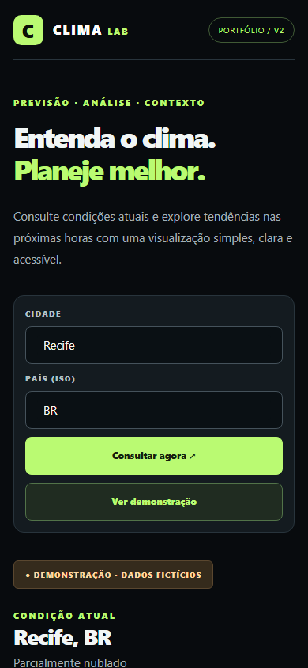

# Clima Lab — previsão e análise meteorológica

**Aplicação Dash moderna com integração segura ao OpenWeatherMap, gráficos interativos e demonstração sem credencial.** Refatoração de um projeto autoral originalmente criado antes das práticas de engenharia atuais.

   

## O problema que resolve

Uma consulta simples de clima nem sempre ajuda a planejar o dia. O Clima Lab apresenta temperatura atual, sensação, vento, umidade e pressão junto com uma projeção interativa, de forma legível em desktop ou celular.

| Desktop | Celular |
| --- | --- |
|  |  |

As imagens e o modo inicial utilizam **dados fictícios** claramente identificados. Não devem ser confundidos com clima real.

## Recursos

- **Consulta real** por cidade e código de país via API OpenWeatherMap (requer chave própria).
- **Demonstração funcional** ao abrir, sem necessidade de configurar chave.
- **Dashboard dark / alto contraste:** condição atual, temperatura, sensação, umidade, vento, pressão e gráfico Plotly com pontos de previsão.
- **Próximos dias:** máximas e mínimas entre as projeções disponíveis.
- **Tratamento de erros:** cidade inválida, local inexistente, chave ausente/inválida, limite de requisições e falhas de conexão.
- **UX:** layout responsivo, estados de carregamento, mensagens compreensíveis, foco de teclado e movimento reduzido.

## Executar

Requer Python 3.12 ou superior (recomendado) e acesso à internet apenas para consultas reais.

```powershell
git clone https://github.com/JackNoArms/Aplicativo_web_clima.git
cd Aplicativo_web_clima
python -m venv .venv
.\.venv\Scripts\python.exe -m pip install -r requirements.txt
.\.venv\Scripts\python.exe app.py
```

Abra **http://127.0.0.1:8050**. Clique em **Ver demonstração** para testar sem credenciais.

Para consultar dados reais, copie `.env.example` para `.env` e informe uma **nova** chave `OPENWEATHER_API_KEY` da sua conta OpenWeatherMap. Nunca insira a chave no código ou em commits:

```dotenv
OPENWEATHER_API_KEY=COLOQUE_SUA_NOVA_CHAVE_AQUI
```

O arquivo `.env` é ignorado pelo Git. O servidor de desenvolvimento escuta apenas em `127.0.0.1`; não exponha a aplicação publicamente sem infraestrutura adequada.

## Arquitetura

```text
app.py              Entrada Dash, carrega .env e inicializa servidor
pages/home.py       Layout, cartões, gráfico, callback e narrativa
services/weather.py Validação, transporte HTTP, interpretação de dados e demo
assets/style.css    UI responsiva com alto contraste
tests/              Testes independentes da API (fixtures sintéticas)
docs/               Capturas e nota de segurança
```

A camada de API usa `requests` com timeout, parâmetros validados e mensagens seguras. Quando ocorre falha, a interface não expõe URL com token nem stack trace.

## Qualidade

```powershell
python -m pip install -r requirements-dev.txt
python -m pytest tests/ -q
```

Validações locais da modernização: **10 testes Python aprovados**, compilação sem erros e **cinco etapas Playwright** aprovadas (desktop, gráfico, falta de chave, demo e mobile 390 px). Os testes da integração são **simulados**; nenhuma API real foi acessada durante o QA.

## Segurança — aviso importante

A versão histórica do projeto continha **uma chave OpenWeatherMap diretamente no código público**. Ela foi removida da versão atual, mas permanece no histórico anterior do Git. **O titular deve revogar essa chave e emitir outra**; deletá-la do arquivo mais recente não revoga sua validade. Consulte [SECURITY.md](docs/SECURITY.md).

**Fonte dos dados em modo real:** [OpenWeatherMap](https://openweathermap.org/api). Projeto independente, sem vínculo oficial com o provedor.
